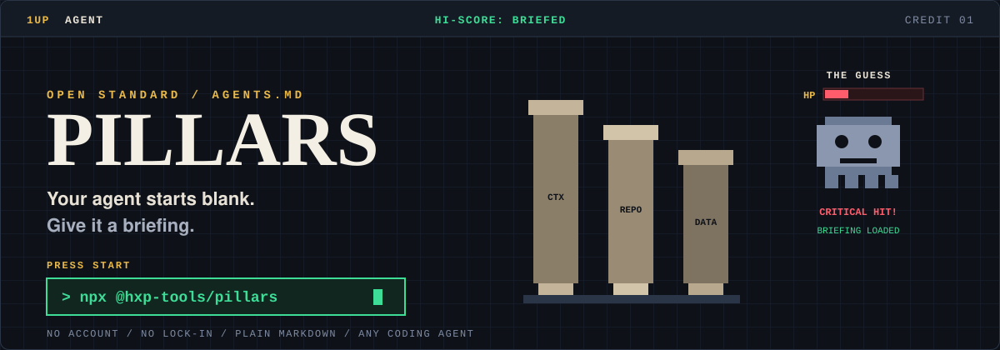
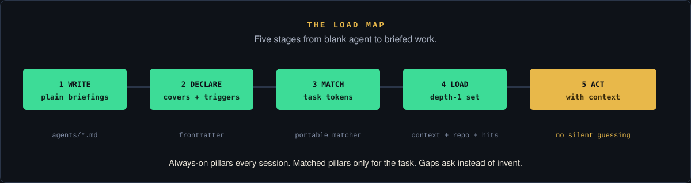
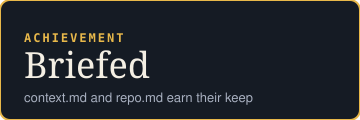
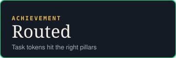

<p align="center">
  
</p>

<p align="center">
  <a href="https://www.npmjs.com/package/@hxp-tools/pillars"></a>
  <a href="CHANGELOG.md"></a>
  <a href="SPEC.md"></a>
  <a href="AGENTS.md"></a>
  <a href="LICENSE"></a>
</p>

<h3 align="center">Your agent starts blank. Give it a briefing.</h3>

<p align="center"><em>Pillars is the onboarding doc your AI coding assistant actually reads.</em></p>

Pillars is a free, open standard for writing down what an AI assistant needs to know about your project before it touches your code. Short markdown files. Plain language. The assistant loads only what the task needs, and stops guessing.

It works with Claude Code, Cursor, Copilot, Codex, Gemini, opencode, Aider, and anything else that reads instructions from your repository. No account, no vendor lock-in. Sibling of [mythify](https://github.com/hannsxpeter/mythify), [godplans](https://github.com/hannsxpeter/godplans), and [godaudits](https://github.com/hannsxpeter/godaudits). Part of [`@hxp-tools`](https://www.npmjs.com/org/hxp-tools).

---

## Press start

```bash
npx @hxp-tools/pillars@latest
```

That installs the skills for every coding tool it finds. Use `--project` for the current repo, `--tools claude,codex` to pick hosts, and `--uninstall` to remove exactly what it installed.

Then, in any project:

```text
/pillars-init
```

In Codex the command is `$pillars-init`; in Windsurf it is `@pillars-init`.

Or paste this into your assistant (no install required):

> *Adopt Pillars 1.2.3. Read SPEC.md and PILLARS.md from https://github.com/hannsxpeter/pillars/tree/v1.2.3. Scaffold the always-loaded stubs and applicable Core stubs, then remove created or excluded identities from the local catalog.*

---

## The boss fight

An AI coding assistant can read your code. It cannot read your reasons.

| You ask | Without Pillars (The Guess wins) | With Pillars |
|---|---|---|
| "Add a customer table" | Random library, invented naming, missing tenant column | Your library, your naming, tenant rule flagged first |
| "Where does this component go?" | A second convention appears overnight | The folder your other components already use |
| "Speed up this query" | Raw SQL that skips your audit logger | Knows the one escape hatch, and why |
| "Why is this code like this?" | Assumes a bug and "fixes" it | Reads the recorded decision and leaves it alone |

Linters catch typos. They cannot catch intent. Pillars is the briefing you would give a new teammate, written once, read every session.

---

## The load map

<p align="center">
  
</p>

| Stage | What happens |
| --- | --- |
| Write | One markdown file per topic under `agents/` |
| Declare | Frontmatter lists covers and trigger words |
| Match | The task tokens pick which pillars matter |
| Load | Always-on `context` + `repo`, plus matches, depth 1 |
| Act | The assistant works with your decisions, not invents them |

There are 24 topics in the catalog: 2 always loaded, 11 Core, 11 Common. Most projects use a focused subset. Marking a topic "not applicable" is a first-class answer.

Full catalog: [PILLARS.md](PILLARS.md). Formal rules: [SPEC.md](SPEC.md).

---

## Achievements

<p align="center">
  
  
  
  
</p>

| Achievement | Earned by |
| --- | --- |
| Founded | `AGENTS.md` and `agents/` exist |
| Briefed | `context.md` and `repo.md` answer what the project is and where things go |
| Routed | A real task loads only the pillars its triggers select |
| Verified | `/pillars-verify` finds no silent drift against the code |

---

## What a pillar looks like

```markdown
---
pillar: data
status: present
covers: [database schema, migrations, queries, storage]
triggers: [database, schema, migration, query, table, postgres]
must_read_with: [auth, config]
---

## Scope
The data layer: schema, migrations, query patterns, storage.

## Context
We use Drizzle ORM against Postgres 16. All table definitions live in
`src/db/schema.ts`. Migrations are generated, never hand-written.

## Decisions
- **Drizzle over Prisma.** We need raw SQL escape hatches for analytics.

## Rules
- Never write raw SQL outside `src/db/raw.ts`.

## Gaps
- Soft delete versus hard delete is still undecided. Ask before choosing.
```

**Decisions** records the reasoning. **Gaps** tells the assistant to ask instead of invent.

---

## Skills

| Skill | Job |
| --- | --- |
| `/pillars-init` | Bootstrap AGENTS.md, stubs, exclusions |
| `/pillars-author` | Draft one pillar from the codebase |
| `/pillars-verify` | Audit pillars against current code |

Paste-in prompts and per-tool guides live in [`tooling/prompts/`](tooling/prompts/). The standard works with nothing installed; skills only automate the housekeeping.

---

## Learn more

| Document | When |
|---|---|
| [SPEC.md](SPEC.md) | Formal rules, short enough for one sitting |
| [PILLARS.md](PILLARS.md) | Topic catalog and starting sets |
| [FAQ.md](FAQ.md) | Practical adoption questions |
| [examples/saas-dashboard/](examples/saas-dashboard/) | End-to-end mini project |

This repository dogfoods the standard: [AGENTS.md](AGENTS.md) and [agents/](agents/) are real.

## Status

Stable 1.2 (Spec: v1.2.3). Backward compatible with 1.1 and 1.0. History: [CHANGELOG.md](CHANGELOG.md).

## License

[CC0 1.0 Universal](LICENSE). Use freely, commercial or not, with or without credit.
